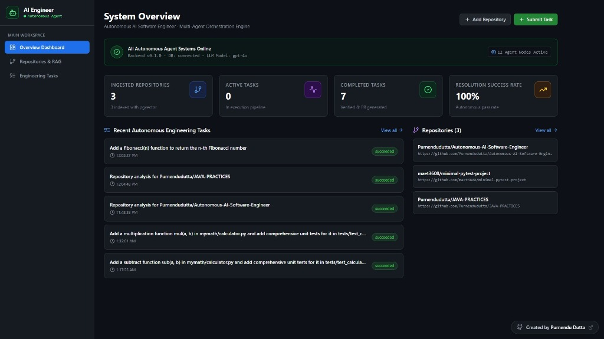
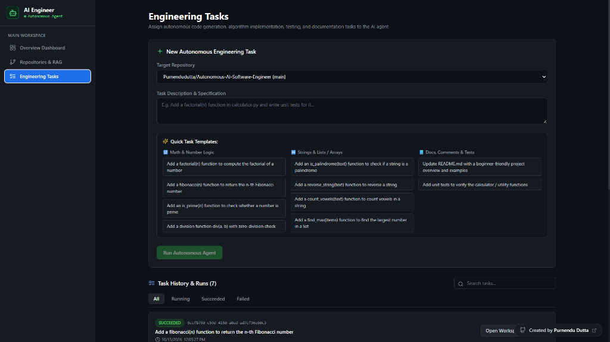
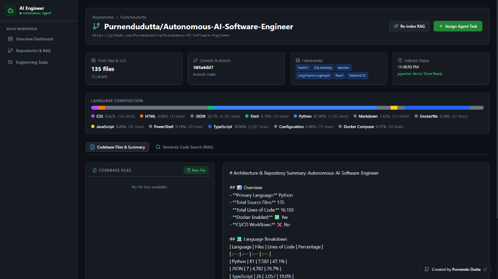
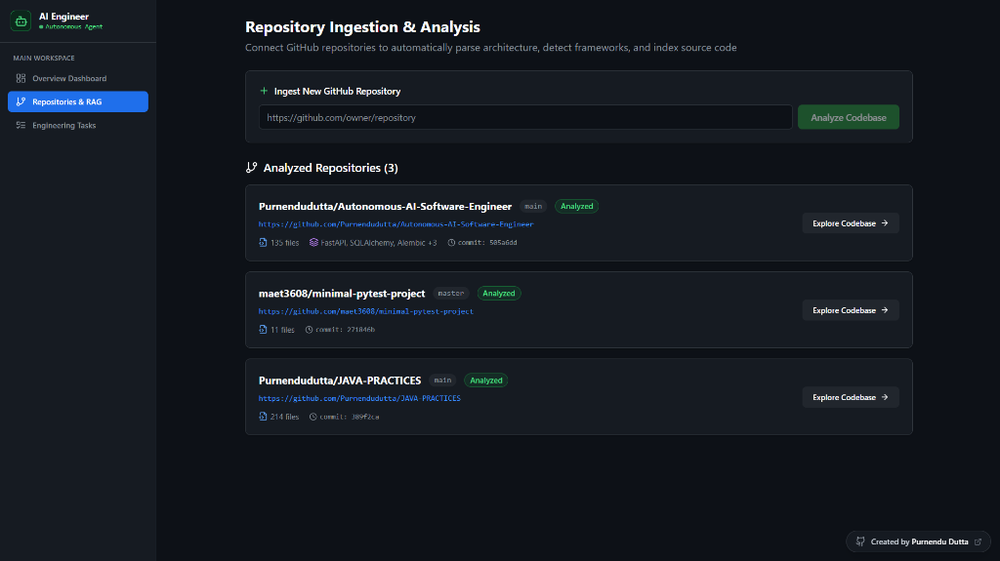

# Autonomous AI Software Engineer 🤖🚀

An enterprise-grade, fully autonomous AI software engineering system capable of ingesting entire codebases, semantically indexing symbols with AST & pgvector RAG, formulating architectural plans via LangGraph, applying surgical `SEARCH/REPLACE` code modifications, executing tests in an isolated Docker sandbox with automated self-correction loops, performing security audits (OWASP), and compiling production-ready Pull Request markdown reports.

---

## 🏗️ Architecture Overview

```
                      ┌─────────────────────────────────┐
                      │    Frontend Web Dashboard       │
                      │  (React 18 + Vite + Monaco)     │
                      └────────────────┬────────────────┘
                                       │ HTTP / REST
                                       ▼
                      ┌─────────────────────────────────┐
                      │      FastAPI Backend Engine     │
                      │       (LangGraph Agents)        │
                      └───────┬─────────────────┬───────┘
                              │                 │
              ┌───────────────▼┐               ┌▼──────────────┐
              │ PostgreSQL 16  │               │ Docker Engine │
              │   + pgvector   │               │ Sandbox (Test │
              │ (AST/Code RAG) │               │ & Correction) │
              └────────────────┘               └───────────────┘
```

---

## ✨ Key Capabilities

1. **Semantic Codebase Ingestion**: Parses AST (Abstract Syntax Trees) to index classes, functions, and cross-file dependencies into `pgvector`.
2. **LangGraph Multi-Agent Architecture**: Dedicated planner, editor, verifier, debugger, and security reviewer agents collaborating in structured state machines.
3. **Surgical Code Modification**: Generates and applies deterministic `SEARCH/REPLACE` blocks to minimize hallucination and syntax degradation.
4. **Sandboxed Self-Correction**: Automatically executes tests within an isolated Docker container, feeding failures back into the debugger until the build passes.
5. **OWASP Security Auditing**: Scans changes for common vulnerabilities, hardcoded secrets, and injection risks.
6. **Production PR Generation**: Compiles rich, structured markdown reports detailing root causes, changes, and verification proof.

---

## 📸 Screenshots & UI Showcase

### 1. System Overview Dashboard
*Real-time multi-agent orchestration status, active agent nodes, ingested repositories, and task resolution metrics.*


### 2. Autonomous Engineering Tasks
*Interactive task assigner with beginner quick templates, natural language prompt specification, and historical run tracking.*


### 3. Codebase Intelligence & Architecture Explorer
*Deep semantic analysis of cloned repositories, automatic language composition breakdowns, framework detection, and file exploration.*


### 4. Repository Ingestion & Semantic RAG
*One-click ingestion of remote GitHub repositories with AST code parsing and vector search indexing.*


---

## ⚡ Quickstart


### Prerequisites
* [Docker Desktop](https://www.docker.com/products/docker-desktop/) (Running)
* [Node.js](https://nodejs.org/) (v18+)
* [Python](https://www.python.org/) (v3.11+)

---

### 1. Environment Setup
Copy the template configuration to create your local `.env`:
```bash
# Windows Command Prompt
copy .env.example .env

# Windows PowerShell
Copy-Item .env.example .env

# macOS / Linux
cp .env.example .env
```

Open `.env` and add your **OpenAI API Key**:
```env
OPENAI_API_KEY=sk-your-openai-api-key
```

---

### 2. Launch Services

#### Option A: One-Click Launcher (Windows)
* Double-click `start.bat` or run `.\start-dev.ps1` in PowerShell.

#### Option B: Manual Startup

**Step 1: Start Database (PostgreSQL + pgvector)**
```bash
docker compose up -d postgres
```

**Step 2: Start Backend**
```bash
cd backend
pip install -r requirements.txt
python -m uvicorn app.main:app --reload --port 8000
```

**Step 3: Start Frontend**
```bash
cd frontend
npm install
npm run dev
```

---

## 🌐 Endpoints & Dashboards

| Service | Address |
| :--- | :--- |
| **Frontend Web Dashboard** | [http://localhost:3000](http://localhost:3000) |
| **Interactive API Documentation** | [http://localhost:8000/docs](http://localhost:8000/docs) |
| **Backend Health Check** | [http://localhost:8000/health](http://localhost:8000/health) |

---

## 📂 Project Structure

```text
Autonomous-AI-Software-Engineer/
├── backend/                  # FastAPI service, LangGraph agents, RAG, database models
│   ├── alembic/              # Database migrations
│   ├── app/
│   │   ├── agents/           # Planner, Editor, Debugger, Reviewer, Verifier
│   │   ├── api/routes/       # Health, RAG, Repositories, Tasks API endpoints
│   │   ├── core/             # Configuration & logging
│   │   ├── database/         # Async SQLAlchemy & pgvector sessions
│   │   └── sandbox/          # Docker execution runner
│   └── requirements.txt      # Python dependencies
├── frontend/                 # React 18, Vite, TypeScript, Tailwind dashboard
│   ├── src/                  # Components, Monaco editor, pages, services
│   └── package.json          # Node dependencies
├── sandbox/                  # Dockerfile & scripts for test execution sandbox
├── .env.example              # Configuration template for developers
├── docker-compose.yml        # Multi-container orchestration (DB, API, Frontend)
├── start.bat                 # Windows one-click batch launcher
└── start-dev.ps1             # PowerShell developer launcher
```

---
